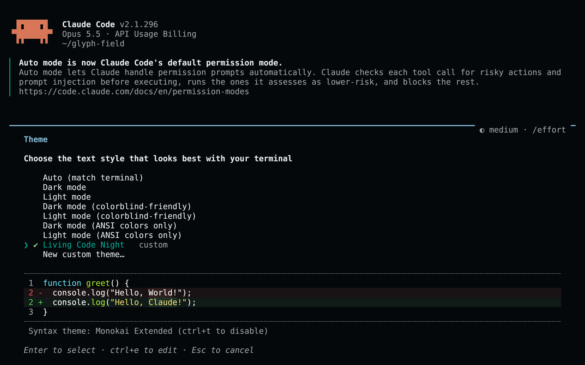
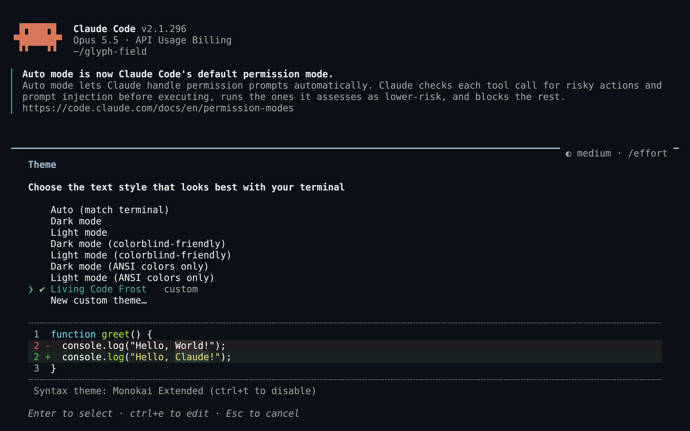
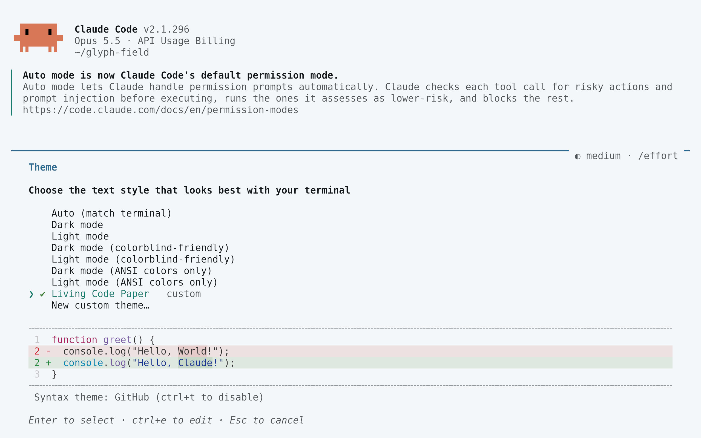
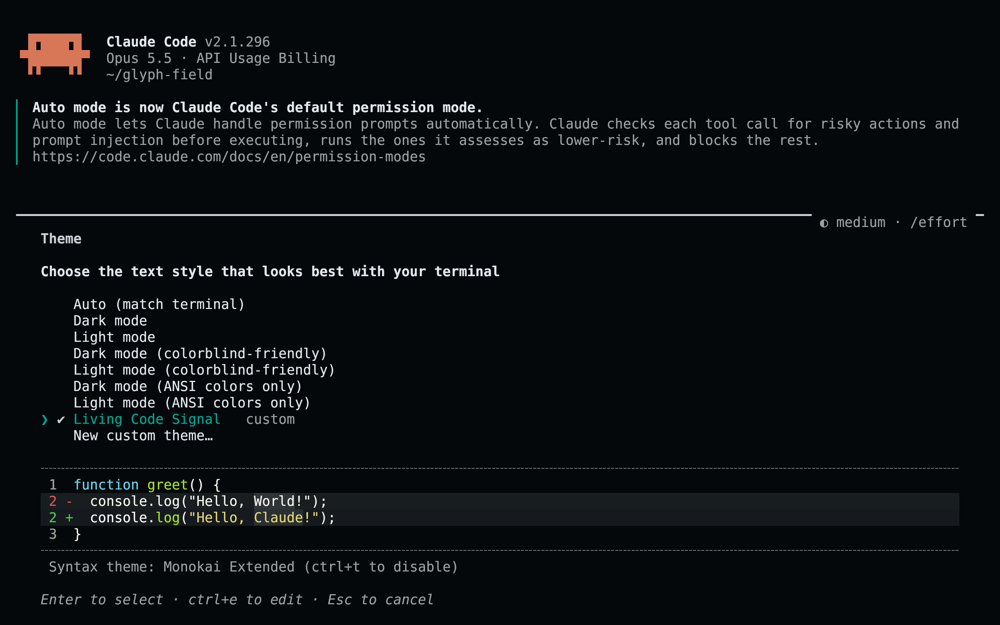

<!-- living-code-readme:1 -->
# ✳️ Living Code for Claude Code

**Calm slate. Living color.** Living Code for Claude Code: prompt accents, permissions, messages, diffs and subagent colors in four native custom themes.

[Installation](#installation) · [Flavors](#flavors) · [Configuration](#configuration) · [All ports](https://github.com/living-code-theme)

## Previews

<table data-lc-flavors>
<tr>
<td width="50%" valign="top">
<strong>Night</strong><br><sub>Dark · full palette</sub><br><br>
<a href="images/night.png"></a>
</td>
<td width="50%" valign="top">
<strong>Frost</strong><br><sub>Dark · softer chroma</sub><br><br>
<a href="images/frost.png"></a>
</td>
</tr>
<tr>
<td width="50%" valign="top">
<strong>Paper</strong><br><sub>Light · near-white slate</sub><br><br>
<a href="images/paper.png"></a>
</td>
<td width="50%" valign="top">
<strong>Signal</strong><br><sub>Dark · teal accent</sub><br><br>
<a href="images/signal.png"></a>
</td>
</tr>
</table>

Select any preview to view the image at full size.

## Installation

```sh
flavor=night # night, frost, paper, or signal
curl -fsSL --create-dirs -o "${CLAUDE_CONFIG_DIR:-$HOME/.claude}/themes/living-code-$flavor.json" "https://raw.githubusercontent.com/living-code-theme/claude-code/main/themes/living-code-$flavor.json"
```

Run `/theme` and select **Living Code Night** (or the flavor you downloaded). Restart Claude Code once if the theme directory did not exist when it started. Later edits hot-reload. This respects `CLAUDE_CONFIG_DIR` when set; no existing settings file is overwritten.

## Flavors

Expand a flavor for its full-size preview and activation instructions.

<details data-lc-flavor="night">
<summary><strong>Night</strong> · Dark · full palette</summary>

<p><a href="images/night.png"></a></p>

Run `/theme` and select **Living Code Night**. Its stored preference is `custom:living-code-night`.

</details>

<details data-lc-flavor="frost">
<summary><strong>Frost</strong> · Dark · softer chroma</summary>

<p><a href="images/frost.png"></a></p>

Run `/theme` and select **Living Code Frost**. Its stored preference is `custom:living-code-frost`.

</details>

<details data-lc-flavor="paper">
<summary><strong>Paper</strong> · Light · near-white slate</summary>

<p><a href="images/paper.png"></a></p>

Run `/theme` and select **Living Code Paper**. Its stored preference is `custom:living-code-paper`.

</details>

<details data-lc-flavor="signal">
<summary><strong>Signal</strong> · Dark · teal accent</summary>

<p><a href="images/signal.png"></a></p>

Run `/theme` and select **Living Code Signal**. Its stored preference is `custom:living-code-signal`.

</details>

## Configuration

The files contain a display `name`, a `base` preset and documented `overrides`. Paper inherits `light`; the other flavors inherit `dark`. Diff backgrounds are tinted separately from the brighter word-level highlights. Shimmer colors and all eight subagent colors are included. Your terminal still owns the main screen background; use a matching Living Code terminal theme.

## Compatibility

Targets the custom-theme JSON API documented in the [Claude Code terminal configuration reference](https://code.claude.com/docs/en/terminal-config#create-a-custom-theme). This is not a status-line workaround or a patched Claude binary. Old versions with only built-in presets need an update. The `effortUltra` override requires Claude Code 2.1.239 or later; older versions ignore unknown tokens. Fullscreen-only surfaces apply only in fullscreen mode. Tests validate the documented token contract; the screenshots show the real custom-theme picker and its native preview.

Previews are captured programmatically from the actual application in an isolated profile. See [`capture/app.py`](capture/app.py) for the app-owned recipe and [`images/capture.json`](images/capture.json) for runtime, palette and image provenance. No mock interface is drawn.

## Contributing

Found a problem? [Open an issue](https://github.com/living-code-theme/claude-code/issues/new/choose) with the app version, the flavor and a screenshot. Want Living Code somewhere else? [Request a port](https://github.com/living-code-theme/core/issues/new?template=port-request.yml).

Pull requests are welcome. Keep this README, `port.json` and `images/` in sync, and use real screenshots of the app, never mockups.

🦎 **One chameleon, many habitats.** Part of [Living Code](https://github.com/living-code-theme).

## License

[MIT](LICENSE) © Elliot Luque
